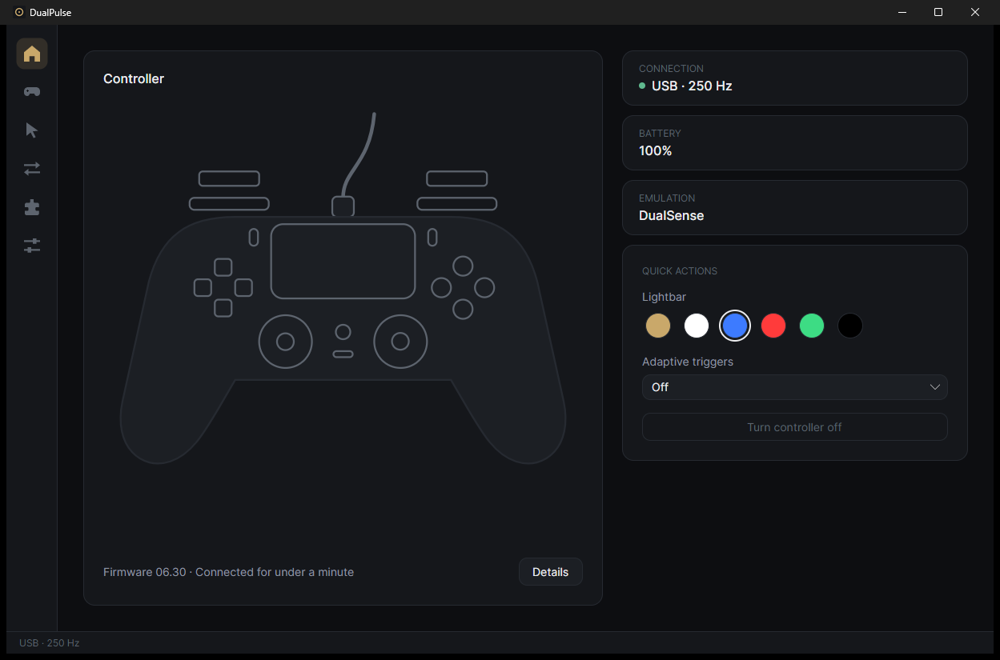

# DualPulse: free DualSense app for PC

Get everything out of a PS5 DualSense controller on Windows, **including over Bluetooth**: adaptive triggers, haptic
feedback, the controller's speaker, lights and controller emulation. Free and open source, a free alternative to DSX.

## Features

- **Wireless haptics, adaptive triggers and speaker** for games with DualSense support, through a virtual DualSense.
- **Haptic feedback over Bluetooth** from game rumble, and PC sound you can feel in the grips.
- **Emulation:** Xbox 360, DualShock 4 or DualSense, with your real controller hidden from games.
- **Adaptive triggers and gyro per game**, switching automatically.
- **PC control:** touchpad as mouse, buttons as keys and media keys.
- **Lightbar, battery LEDs, mic mute button**, and DSX mods.

## Get started

1. Download the zip from [Releases](https://github.com/elvisgraho/DualPulse/releases/latest), unzip it and run
   `DualPulse.exe`. If Windows says it protected your PC, click **More info**, then **Run anyway**.
2. Connect your DualSense by cable or Bluetooth.
3. On the Emulation page, pick what games see. DualPulse links the driver a mode needs:
   [ViGEmBus](https://github.com/nefarius/ViGEmBus/releases) for Xbox 360 and DualShock 4,
   [usbip-win2](https://github.com/vadimgrn/usbip-win2/releases) for DualSense, and
   [HidHide](https://github.com/nefarius/HidHide/releases) to hide the real controller.

After Bluetooth, the controller ignores game haptics over the cable until you turn it off and on again. More:
[virtual DualSense](docs/virtual-dualsense.md).

## Build from source

`dotnet build src/DualPulse.slnx -c Release` with the .NET 10 SDK. Details: [BUILDING.md](BUILDING.md).

## Credits

Originally based on DualSenseX by Paliverse; rewritten from scratch. [Third-party notices](THIRD-PARTY-NOTICES.md).
"DualSense" and "PS5" are trademarks of Sony Interactive Entertainment; DualPulse is not affiliated with Sony or
Paliverse. [MIT license](LICENSE) · [Privacy policy](PRIVACY.md).

Free code signing provided by [SignPath.io](https://signpath.io), certificate by [SignPath Foundation](https://signpath.org).
[Code signing policy](https://elvisgraho.github.io/DualPulse/#code-signing-policy).
